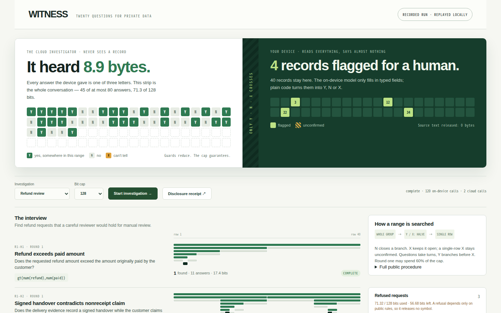

# WITNESS

**The cloud investigator never sees the source records. It learns only yes, no, or unknown from the device.**

A reviewer wants to find questionable refunds, expenses without evidence, or customers still owed a reply. Sending an entire ledger to a cloud model is a large disclosure for a small decision. WITNESS lets a cloud model propose tests while the records and flagged row positions stay on the device.



*Recorded execution, replayed locally for this screenshot. Refund review: 4 findings, 45 answers, 71.32 answer-channel bits, 120 local model calls and 2 cloud calls. This image replays the earlier direct-transport run, not the new Firebase SDK measurement.*

## How it works

1. The cloud investigator receives a public objective, row count, typed field dictionary, candidate expressions and the public search procedure. It proposes expression trees in two rounds, without source records or an answer key.
2. On-device Nano 4 extracts typed facts through Firebase AI Logic: `getGenerativeModel(..., {mode: InferenceMode.ONLY_ON_DEVICE, onDeviceParams: ...})` followed by `generateContentStream()`. JSON schemas go through `promptOptions.responseConstraint`; system messages, when used, go through `createOptions.initialPrompts`. The SDK calls Chrome's device model internally. Missing device support or local errors stop extraction; source records have no cloud fallback. The former direct Prompt API transport remains available only through explicit dependency injection for comparisons.
3. Local code validates and evaluates each expression against those facts. Public code searches record ranges, splitting Y/X branches and closing N branches. A singleton X stays unconfirmed. Equivalent predicates share a scan.
4. Each released answer is Y (yes), N (no), or X (unknown). The default cap is **128 bits = 16 information-equivalent bytes per session**. The search stops before exceeding it. Two-round cloud feedback consists of aggregate Y/X counts derived from the charged answers, with public rejection reasons; row positions remain local.

Each three-valued answer is charged `log2(3)` bits. At 128 bits, at most 80 answers fit. Those symbols are encoded as letters in the application: **16 bytes is an information bound on this answer channel, not the size of network traffic or the JSON receipt**. A local disclosure receipt records the answers, cap, expressions, refusals, reused work and coverage.

## Try it without keys — demo mode

Use Node.js **22.22.1 or newer compatible with the locked toolchain** and npm (tested with npm 10.9.4). Start with an extracted copy of this repository and no private environment file. From its root:

```sh
npm ci
npm test
npm run build
npm run dev -- --port 5173
```

Open **http://localhost:5173/** for the current wall layout. With no Firebase settings this is a ready-state preview; its **Start investigation** button requires live models. It does not run a key-free tree investigation.

For the functioning key-free, scripted baseline, open **http://localhost:5173/?legacy** in the same server:

1. Confirm the mode says **demo mode** and the investigator is **Baseline · scripted witness**.
2. Select **128 bits** under CAP (this older view starts at 64).
3. Leave **Refund review** selected and click **Start investigation →**.
4. Inspect the findings and open the disclosure receipt. Save a browser screenshot if desired.

The baseline runs entirely in the browser on synthetic fixtures. It uses neither Nano nor a cloud model and is not evidence of live-model quality. No `.env.local`, Firebase account or model download is needed. Stop the server with Ctrl+C when finished. `npm run build` produces a demo-only bundle; `npm run preview -- --port 5173` serves it with the same URLs. The build configuration deliberately excludes private `VITE_` settings.

## Run the actual models with your own Firebase project

The measured setup was desktop **Chrome Canary 160** with **chrome://flags/#gemma4-for-built-in-ai** enabled and the local Nano 4 model available. Other Chrome builds and hardware have not been validated for these results. Follow the [Firebase hybrid setup](https://firebase.google.com/docs/ai-logic/hybrid/web/get-started) for current platform prerequisites; its general Chrome minimum does not establish that the required Nano 4 model is installed. The app has no model downloader or browser setup wizard.

1. Use your own existing **Spark project with no linked billing**, register a Web app, and enable Firebase AI Logic using the Gemini Developer API in the Firebase console. The current investigator requests `gemini-3.5-flash-lite`. Confirm its availability and your project's free quota before running.
2. Register the Web app with [Firebase App Check / reCAPTCHA Enterprise](https://firebase.google.com/docs/app-check/web/recaptcha-enterprise-provider). Supply its site key. For local development, privately register an App Check debug token in that project's console. The app uses a CustomProvider and the documented token exchange to avoid the SDK's debug-token console logging. A nonempty site-key setting is still required by the app's configuration gate when using a debug token. Do not disable App Check.
3. Allow **localhost** for the Web application's origins and HTTP-referrer API-key restrictions. Include the actual localhost URL pattern for your port in those restrictions. Use **http://localhost:5173/**, not `127.0.0.1`; they are different origins.
4. Prepare a private settings file:

```sh
cp .env.example .env.local
```

Edit only your private copy. The field names are:

| Field | What to enter privately |
| --- | --- |
| `VITE_MODEL_MODE` | `firebase` |
| `VITE_FIREBASE_API_KEY` | Your project's Web app API key, never a Gemini server key |
| `VITE_FIREBASE_PROJECT_ID` | Your project ID |
| `VITE_FIREBASE_APP_ID` | Your registered Web app ID |
| `VITE_APP_CHECK_SITE_KEY` | Your App Check site key |
| `VITE_APP_CHECK_DEBUG_TOKEN` | Privately registered token for local testing, or blank for reCAPTCHA |
| `VITE_SPARK_FREE_TIER_CONFIRMED` | `true` only after checking that billing is not linked |
| `VITE_WITNESS_MODE` | Optional legacy experiment setting; leave commented for the current tree view |

No example key or token is supplied. `.env.local` is ignored by git. The confirmation field is an operator gate, not a billing API check or a quota guarantee. Do not put these values in screenshots, submissions, shared files or logs.

5. Restart the local development server:

```sh
npm run dev -- --port 5173
```

Open **http://localhost:5173/** in the configured Canary. Keep the default **128** cap, choose a task and click **Start investigation →**. The first local model preparation may require a model download and a user gesture. Inspect the disclosure receipt after completion. Cloud calls are paced at least 13 seconds apart within a page; local extraction can take time. Do not interpret a stalled or failed investigation as a clean result. This repository does not configure or deploy a live production build.

If the legacy page stays in demo mode, check the required settings and restart Vite. If App Check or AI Logic returns 403, check project registration, token registration and the exact hostname/referrer. If local inference is unavailable, check Canary, the flag and model readiness. No cloud fallback is permitted for source-bearing local extraction.

## Measured results

The November 17, 2026 remeasurement below uses **Firebase AI Logic for both inference paths**: cloud proposals through `ONLY_IN_CLOUD`, and source-bearing Nano 4 extraction through `ONLY_ON_DEVICE`. The SDK device route was verified with native call stacks, structured responses, response provenance and an isolated local-only run with **zero external requests**. The browser reported Canary 160.0.8165.0, the v4 feature flag, `prompt_api_gemma4` available and the ready `gemma4_component` version `2026.11.3.1140`. Firebase identifies the response as on-device; the model version evidence comes from Chrome, not an SDK model-name field.

The public schema, v2 investigator instructions, prompts, search procedure and 128-bit cap were held fixed. Each task was run once through the SDK route. The previously new holdout (seed **202611171001**) was reused unchanged for this comparison; this is a remeasurement of that fixed set, not a newly untouched holdout. Cloud proposals were freshly generated, so changes in search work and time cannot be attributed solely to the transport. The direct baselines are the original repeat 1 and holdout runs recorded earlier that day.

| Route | Set | Task | Confirmed / expected | False | Answers / bits | X | Cloud / local calls | Seconds |
| --- | --- | --- | --- | --- | --- | --- | --- | --- |
| Direct (earlier) | original | receipt | 4/4 | 0 | 67 / 106.19 | 11 | 2 / 180 | 46.35 |
| Firebase SDK | original | receipt | 4/4 | 0 | 69 / 109.36 | 12 | 2 / 181 | 194.62 |
| Direct (earlier) | original | refund | 4/4 | 0 | 45 / 71.32 | 0 | 2 / 120 | 34.38 |
| Firebase SDK | original | refund | 4/4 | 0 | 47 / 74.49 | 1 | 2 / 121 | 142.58 |
| Direct (earlier) | original | reply | 2/2 | 0 | 11 / 17.43 | 0 | 2 / 6 | 16.06 |
| Firebase SDK | original | reply | 2/2 | 0 | 11 / 17.43 | 0 | 2 / 6 | 16.06 |
| Direct (earlier) | holdout | receipt | 3/4 | 0 | 67 / 106.19 | 18 | 2 / 180 | 46.32 |
| Firebase SDK | holdout | receipt | 3/4 | 0 | 67 / 106.19 | 18 | 2 / 181 | 199.46 |
| Direct (earlier) | holdout | refund | 4/4 | 0 | 46 / 72.91 | 0 | 2 / 160 | 42.51 |
| Firebase SDK | holdout | refund | 4/4 | 0 | 47 / 74.49 | 1 | 2 / 121 | 141.43 |
| Direct (earlier) | holdout | reply | 2/2 | 0 | 9 / 14.26 | 0 | 2 / 6 | 22.06 |
| Firebase SDK | holdout | reply | 2/2 | 0 | 9 / 14.26 | 0 | 2 / 6 | 16.05 |

The Firebase SDK route confirmed **10/10 original issues and 9/10 holdout issues**, with **0 false findings** and **12 cloud calls** across six task runs. Unfinished expressions at the cap: 0. Earlier direct measurements were 10/10 and 9/10 respectively, with zero false findings. Unknown answers were never forced into yes. These are ten planted issues in each small synthetic set, not ten independent real-world customers.

The additional 732-case extraction check matched the earlier direct answers in 729 cases. SDK correctness against that check's expected answers was 667/732 versus the earlier 670/732; all three differences were local inference failures (two `UnknownError`, one 20-second `AbortError`) handled as unknown. Prompts were unchanged. This check includes deliberately unsupported questions; its model-answer score is separate from the 175/175 passing software tests and the task findings above.

Seconds are elapsed wall-clock time per task, including cloud waiting and local inference. The SDK route was slower in this run; no speed improvement is claimed. No paid setup, plan upgrade or quota increase was performed. The harness enforced a local 18-attempt cloud ceiling and at least 13 seconds between starts, based on the previously observed 5 requests/minute free-tier limit. Project-wide remaining daily/token quota was not queried; these measurements do not establish a universal free quota.

### Measurement method and reproducibility boundary

The live harness generated two rounds of cloud expression proposals, executed public group search locally, recorded Y/N/X exchanges and inference-call counts, and compared flagged singleton slots against synthetic answer keys after execution. Bits are the number of charged symbols multiplied by `log2(3)`; merged work is not charged again. Findings are confirmed singleton Y slots, deduplicated before scoring. False findings are flagged slots outside the planted key. Unfinished expressions count pending search ranges, not uncertain singleton X answers.

`npm test` checks the protocol, parser, deterministic extraction integration, search/cap enforcement and model adapters. It does **not** reproduce these live measurements. `npm run benchmark` runs the retained scripted baseline, not the table above. Historical run files, private settings, the evaluation harness and the frozen holdout are deliberately absent from this clean source copy. Exact reproduction of the historical table is therefore not provided here. A fresh live UI run can produce a disclosure receipt on the included development fixtures, but should be treated as a new experiment.

## Limits and unfinished work

- The cap covers the fixed answer channel, conditional on the public task/schema/procedure. Public setup, HTTP/JSON overhead, timing, App Check, model downloads, other transport metadata and repeated sessions are outside it. It is not differential privacy, encryption, a signed audit or a claim of zero leakage.
- Y/N/X can still reveal sensitive facts. The cap limits their information capacity; validation and refusal guards do not prove that every question is harmless.
- The live UI's cloud follow-up receives aggregate counts derived from the charged symbols, not a literal copy of the displayed strip. The strip and row findings are displayed locally. The headline describes the source-dependent answer channel.
- A model can extract the wrong fact or choose incomplete hypotheses. The small synthetic measurements do not establish production accuracy, latency, cost savings or robustness against arbitrary attacks. No such claims are made.
- The wall view needs real models to execute. The key-free scripted demo uses the existing legacy view. Browser/model setup remains manual. Mobile platforms and a production deployment have not been implemented or validated here.
- No public repository, public video or hosted judging link is included in this preparation bundle. The actual extraction path now uses Firebase AI Logic `ONLY_ON_DEVICE`; Canary call stacks and SDK response provenance were checked during the new measurements below. Public repository, video, hosted judging access and final submission remain unfinished.

## What was built and what is reused

During the November 2026 submission period, this prototype added the bounded ternary answer ledger, typed local extraction, validated expression trees, two-round cloud proposals, deterministic range search with equivalent-predicate reuse, disclosure receipts, synthetic review fixtures, tests and the wall interface. The measurements and interface shown here are from that work. AI coding assistance was used. No third-party application template or customer dataset is bundled; the named packages below are the reused infrastructure.

## License and open-source acknowledgments

By **[kks0488](https://github.com/kks0488)**. WITNESS source is licensed under **Apache-2.0**; see [LICENSE](LICENSE).

| Dependency | Version in package manifest | License / upstream |
| --- | --- | --- |
| Firebase JavaScript SDK | 13.3.0 | Apache-2.0 · [firebase-js-sdk](https://github.com/firebase/firebase-js-sdk) |
| TypeScript | 7.0.2 | Apache-2.0 · [TypeScript](https://github.com/microsoft/TypeScript) |
| Vite | 8.3.8 | MIT · [Vite](https://github.com/vitejs/vite) |
| Vitest | 5.1.0 | MIT · [Vitest](https://github.com/vitest-dev/vitest) |
| tsx | 4.23.15 | MIT · [tsx](https://github.com/privatenumber/tsx) |
| Node.js type definitions | 26.6.6 | MIT · [DefinitelyTyped](https://github.com/DefinitelyTyped/DefinitelyTyped) |

Transitive dependency versions are pinned in `package-lock.json`; their individual licenses accompany the packages installed by `npm ci`. Chrome, Nano, Gemini and hosted Firebase services are external prerequisites with their own terms, not model weights or services licensed by this repository.
